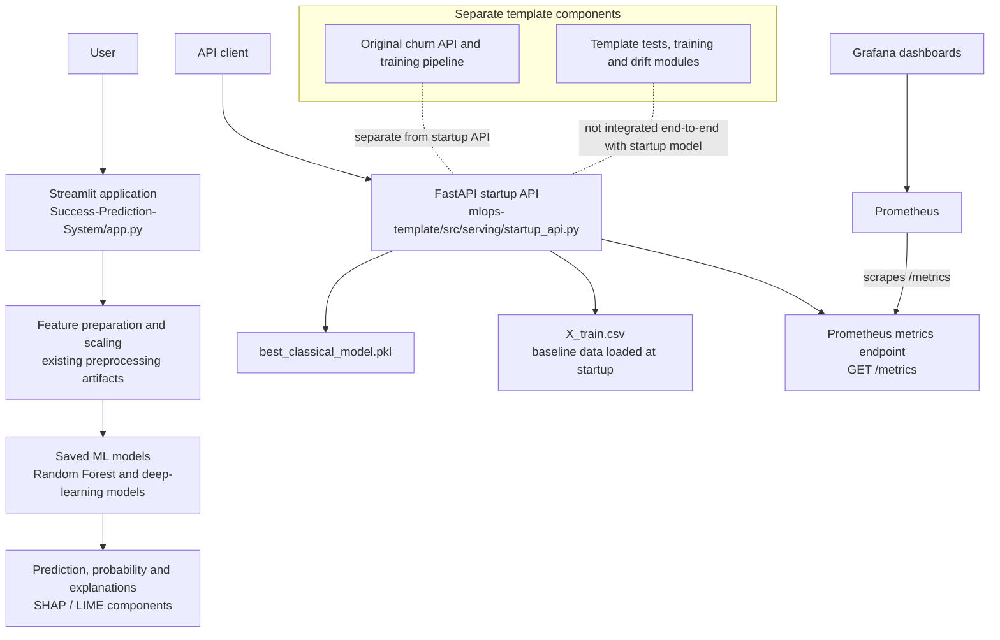

# System Architecture and Block Explanation

## 1. Purpose and scope

This project combines a Streamlit startup-outcome prediction application with a separate FastAPI inference service and a Prometheus/Grafana monitoring path. The prediction target implemented by the supplied model is **Acquired (1) versus Closed (0)**. It does **not** directly predict whether a startup will successfully raise its next funding round.

## 2. Architecture diagram

## 3. Architecture blocks

| Block | Responsibility | Implementation |
|---|---|---|
| User interface | Lets a user enter startup information and inspect predictions and analysis | Streamlit app in `Success-Prediction-System/app.py` |
| Data preparation | Cleans data, engineers domain features and applies preprocessing used by the trained model | Startup project artifacts and preprocessing workflow |
| Model artifacts | Persist trained estimators and supporting preprocessing/feature metadata | `best_classical_model.pkl`, neural-network `.keras` files, scaler and feature-name artifacts |
| Prediction and explainability | Produces the acquired/closed outcome and model explanations in the interactive app | Streamlit app with SHAP/LIME-related assets and outputs |
| Startup inference API | Accepts pre-engineered numeric features and returns single or batch predictions | `mlops-template/src/serving/startup_api.py` |
| Baseline data | Loaded by the startup API when it starts; retained as a baseline reference in the current implementation | `Success-Prediction-System/X_train.csv` |
| Metrics endpoint | Exposes prediction counters, latency histogram and acquisition-rate gauge | `GET /metrics` in startup API |
| Prometheus | Scrapes the startup API metrics endpoint every 15 seconds | `mlops-template/monitoring/prometheus.yml` |
| Grafana | Displays monitoring data queried from Prometheus | Grafana service in `docker-compose.yml` |

## 4. Main data flows

### Streamlit flow
1. The user opens the Streamlit application.
2. The user supplies startup information through the interface.
3. The application uses the startup project's preprocessing and saved model artifacts.
4. The application presents the predicted outcome and related probability/explanation views.

### API flow
1. An API client sends a JSON request containing the model's exact feature names and numeric values.
2. FastAPI checks that the feature set matches the model's 41 expected features.
3. The service creates a one-row pandas DataFrame in model feature order.
4. The Random Forest model returns a class and class probabilities.
5. The API returns the prediction, acquired probability, model name and inference latency.
6. Prometheus scrapes `/metrics`; Grafana visualizes the metrics through Prometheus.

## 5. Deployment boundary and known gaps

The startup API is run directly as a Python/FastAPI process in the verified setup. The supplied Docker Compose stack also contains an `api` service, but the existing Dockerfile launches the template's original customer-churn API (`src.serving.app:app`), not `startup_api.py`. Therefore the Docker `api` service must not be described as a verified container deployment of the startup API.

The MLOps template's churn training, feature engineering, drift endpoint and tests are separate from the startup acquisition service. Startup-specific drift detection and MLflow experiment tracking are not implemented and verified as integrated features in this submission.
