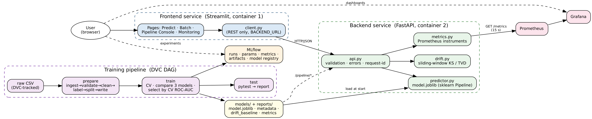
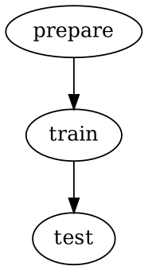

# 1. Architecture Diagram and Block Explanation

**Project:** Startup Outcome Prediction — an AIOps application that predicts whether a startup will be **acquired** or **closed**.

*Source: `docs/architecture.dot` (regenerate with `dot -Tpng architecture.dot -o architecture.png`).*

## 1. Two independent application services

| Service | Container | Technology | Contains |
|---|---|---|---|
| **Frontend** | `Dockerfile.frontend` | Streamlit | UI pages and `client.py` only. **No model code, no pipeline code.** |
| **Backend** | `Dockerfile.backend` | FastAPI + scikit-learn | Model, feature engineering, validation, drift monitor, metrics, pipeline-status endpoints |

They are connected **only** by REST/JSON over HTTP. The frontend learns the backend address from the `BACKEND_URL` environment variable (default `http://localhost:8000`; `http://backend:8000` in Docker Compose). Either side can be replaced or scaled without touching the other — this is the loose coupling the guidelines require.

## 2. Block-by-block explanation

### Frontend (Streamlit)
| Block | File | Responsibility |
|---|---|---|
| Predict page | `frontend/app.py` | Form built **from the backend's `/schema`**; shows outcome, probability and "what influenced this" factors |
| Batch page | `frontend/pages/1_Batch_Prediction.py` | CSV upload → `/predict/batch` → downloadable results |
| Pipeline Console | `frontend/pages/2_Pipeline_Console.py` | Pipeline DAG, data-engineering timings/throughput, model comparison, run history (successes **and failures**), traceability |
| Monitoring page | `frontend/pages/3_Monitoring.py` | Data-drift status and per-input drift scores |
| REST client | `frontend/client.py` | The single place that talks HTTP; converts failures to user-friendly messages |

### Backend (FastAPI)
| Block | File | Responsibility |
|---|---|---|
| API layer | `src/serving/api.py` | Endpoints, request-id middleware, access logging, centralised error handling |
| Contracts | `src/serving/schemas.py`, `field_meta.py` | Pydantic request/response models with range and cross-field validation; labels/help text for the UI |
| Predictor | `src/serving/predictor.py` | Loads `model.joblib`; predictions; occlusion-based explanations. No web-framework dependency (unit-testable) |
| Drift monitor | `src/monitoring/drift.py` | Sliding window of live requests vs. the training baseline (KS test for numbers, total-variation distance for categories) |
| Metrics | `src/monitoring/metrics.py` | Prometheus counters, histograms and gauges |

### Training pipeline (DVC DAG)

| Stage | Code | Output |
|---|---|---|
| `prepare` (data engineering) | `src/data/prepare.py`, `schema.py` | `train.csv`, `test.csv`, `data_report.json` (stage timings, throughput, data-quality report) |
| `train` | `src/training/train.py`, `src/features/engineering.py` | `model.joblib`, `model_metadata.json`, `drift_baseline.json`, `metrics.json`, plots |
| `test` | `tests/` | `reports/test_report.xml` |

The saved model is **one scikit-learn `Pipeline`**: `StartupFeatureBuilder → ColumnTransformer → estimator`. Because the API serves this exact object, training and serving share one implementation of feature engineering (no train/serve skew), and the API accepts raw, human-readable inputs.

### MLOps tooling
| Tool | Role in this project |
|---|---|
| **DVC** | Pipeline DAG (`dvc.yaml`), data/model versioning, `dvc repro` = CI for the pipeline; local (non-cloud) remote |
| **Git** | Source versioning; every run is tagged with the commit hash |
| **MLflow** | Experiment tracking (one parent run + one nested run per model), model registry (`startup-outcome-classifier`), MLflow Projects (`MLproject`) |
| **Prometheus** | Scrapes `GET /metrics` every 15 s; alert rules in `monitoring/alerts.yml` |
| **Grafana** | Pre-provisioned dashboard `Startup Outcome Service` (12 panels) |
| **Docker / Compose** | Backend and frontend as two separate services, plus MLflow, Prometheus, Grafana |

## 3. Key data flows

**Prediction:** browser → Streamlit → `client.py` → `POST /predict/explain` → Pydantic validation → `Predictor` (full pipeline: features → encode → model) → JSON → UI. In the same request the API updates Prometheus metrics and the drift window.

**Training:** raw CSV (DVC-tracked) → `prepare` (validate, clean, label, stratified split) → `train` (5-fold CV on train only → fit → single evaluation on test → MLflow logging → promote best-by-CV model) → artifacts in `models/` and `reports/` → loaded by the backend at start-up.

**Monitoring:** backend `/metrics` → Prometheus → Grafana; drift results are also exposed as metrics and shown in the Monitoring page.

## 4. Traceability chain
Every served model carries (in `/model/info` and `models/model_metadata.json`): **git commit hash**, **SHA-256 of the training data**, **MLflow run id**, training time, metrics. Any prediction can therefore be tied to one code version, one data version and one MLflow run.
