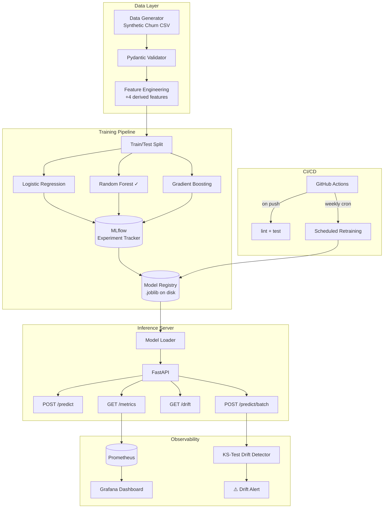

# End-to-End MLOps Template

   

> Production-grade MLOps template: synthetic data generation → feature engineering → MLflow-tracked training → FastAPI inference server → Prometheus/Grafana monitoring → KS-test drift detection. The pipeline is the product — the model is a churn classifier, but the patterns apply to any tabular ML problem.

---

## Problem

Most ML projects die at the notebook. This template shows the full path from raw data to a monitored, deployable inference service — with experiment tracking, model versioning, scheduled retraining, and drift alerts built in from day one.

---

## Architecture



---

## Demo

```
$ make generate && make train
Generated 5000 rows → ./data/raw/churn_data.csv | Churn rate: 26.4%
Training random_forest…
  AUC=0.8821  F1=0.6134  Acc=0.8140
Model saved to ./models/churn_classifier.joblib

$ make serve
# → http://localhost:8000/docs
# → http://localhost:8000/metrics  (Prometheus)

$ make mlflow-ui
# → http://localhost:5000  (MLflow experiment tracker)
```

---

## Quickstart

```bash
git clone https://github.com/DataScienceAIpath/mlops-template
cd mlops-template
pip install -e ".[dev]"
cp .env.example .env

make generate          # create synthetic dataset
make train             # train + log to MLflow
make train-all         # compare all 3 model types
make mlflow-ui         # open MLflow at http://localhost:5000
make serve             # inference API at http://localhost:8000/docs
make test              # full test suite
```

### Full stack with Docker

```bash
docker-compose up --build
# API:        http://localhost:8000
# MLflow:     http://localhost:5000
# Prometheus: http://localhost:9090
# Grafana:    http://localhost:3000  (admin/admin)
```

---

## Tech Stack

- **scikit-learn** — Logistic Regression, Random Forest, Gradient Boosting
- **MLflow** — experiment tracking, model logging, artifact storage
- **FastAPI + Uvicorn** — async inference server
- **Prometheus Client** — prediction counter, latency histogram, drift gauge
- **Grafana** — dashboard config (JSON in `monitoring/grafana/`)
- **SciPy (KS test)** — statistical drift detection
- **Pydantic** — input validation at the API boundary
- **Docker + docker-compose** — multi-service stack (API, MLflow, Prometheus, Grafana)
- **GitHub Actions** — CI lint+test + scheduled weekly retraining workflow
- **pytest** — 20 tests across data, features, training, drift, and serving

---

## Key Files

| Path | Role |
|------|------|
| `src/data/generate.py` | Synthetic churn data with realistic feature correlations |
| `src/data/validate.py` | Pydantic `CustomerFeatures` — input validation |
| `src/features/engineering.py` | 4 derived features: charges ratio, long-term flag, engagement, high-value |
| `src/training/train.py` | Full pipeline: split → train → evaluate → MLflow log → save |
| `src/training/evaluate.py` | Accuracy, AUC-ROC, F1, precision, recall |
| `src/serving/app.py` | FastAPI: `/predict`, `/predict/batch`, `/metrics`, `/drift` |
| `src/monitoring/metrics.py` | Prometheus counters, histograms, and gauges |
| `src/drift/detector.py` | KS-test drift detection vs training baseline |
| `monitoring/prometheus.yml` | Prometheus scrape config |
| `monitoring/grafana/dashboard.json` | Grafana dashboard panels |
| `.github/workflows/train.yml` | Scheduled retraining (weekly) + manual trigger |

---

## Scaling to Production

| Component | Dev (this repo) | Production |
|-----------|----------------|------------|
| Model registry | `./models/*.joblib` | MLflow Model Registry + S3 |
| Experiment tracking | Local `./mlruns` | MLflow Tracking Server (RDS backend) |
| Training scheduler | GitHub Actions cron | Apache Airflow / Kubeflow Pipelines |
| Monitoring | Prometheus + Grafana | Grafana Cloud / Datadog |
| Feature store | In-memory pipeline | Feast / Vertex AI Feature Store |
| Drift detection | KS test | Evidently AI / WhyLogs |

---

## License

MIT © Maniswaroop M
